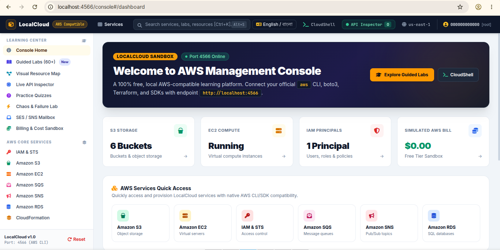
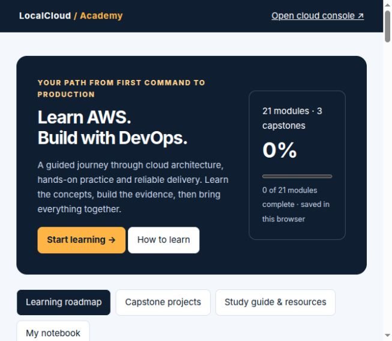
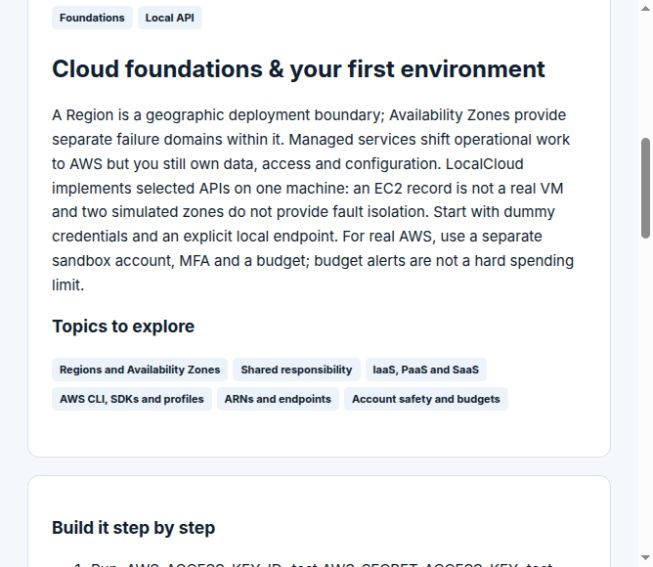
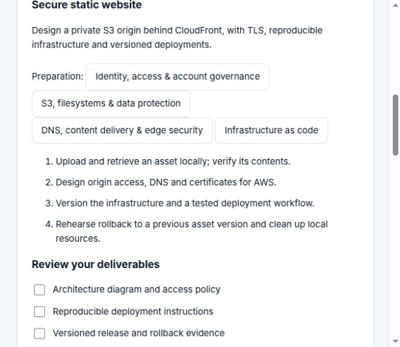
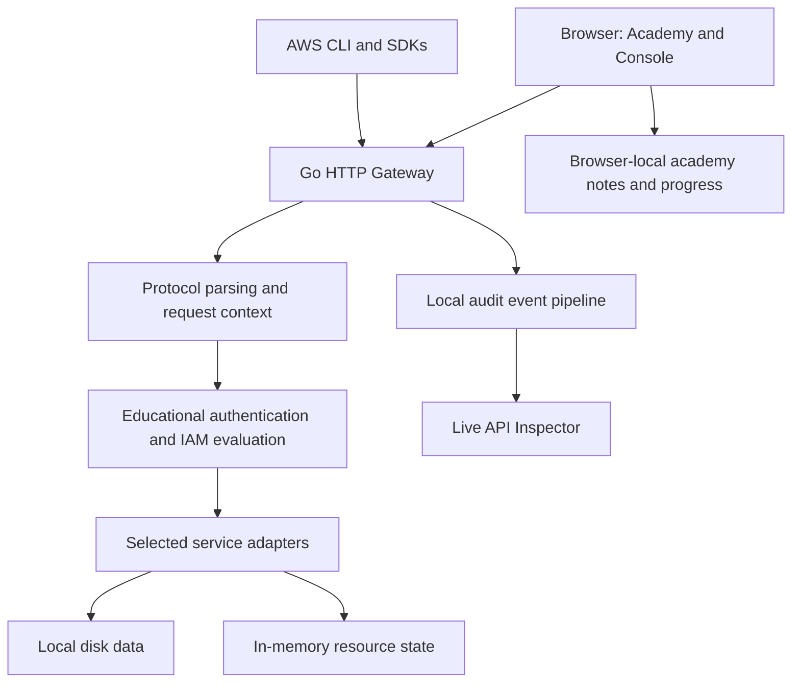

<div align="center">

# LocalCloud

### Learn AWS. Practice DevOps. Build your next cloud team.

An open-source local cloud playground and guided academy — from your first AWS CLI command to architecture, delivery pipelines and recovery planning.

**21 learning modules · 3 portfolio capstones · 17 service adapters · Apache-2.0**

[Get started](#quickstart) · [See the application](#application-gallery) · [Explore the curriculum](#complete-learning-roadmap) · [Business value](#business-value-and-time-savings) · [Compatibility](#service-api-catalog)



**Built by [Imran Ahmed](https://imrandev.bd)**

</div>

## Why LocalCloud?

Cloud learning is easier when you can connect an idea to a command, inspect the result and try again. LocalCloud brings a learning roadmap, selected AWS-compatible APIs and a browser console into one repository you can run on your own machine.

Use it to practice supported API workflows with dummy credentials, introduce new engineers to cloud concepts, and turn lessons into portfolio evidence. Local-only practice does not require an AWS account or generate AWS service charges. Your own hardware, hosting, internet and any separately deployed AWS resources still have their own costs.

**Current scope:** an educational simulator and development playground. It does not replace AWS, implement every AWS service, or guarantee production compatibility. Some features execute locally; others model resource metadata or provide design exercises. Those distinctions are documented below so you can choose the right tool for each stage.

## Application gallery

Real screenshots captured from the running application, stored in this repository so they render on GitHub without a separate image host.



| Learn the concepts | Turn learning into deliverables |
|---|---|
|  |  |
| Clear explanations, topic maps and practical steps. | Project preparation, implementation milestones and review checklists. |

The lead screenshot shows the console dashboard; the gallery shows the academy, lesson content and project checklists. Dashboard counts and labels reflect the captured session; see the feature catalog below for current coverage and limitations.

## Who can use it?

| Audience | Opportunity | Useful output |
|---|---|---|
| Beginners and students | Follow a sequence instead of guessing what to learn next | Learning notes, commands and practical evidence |
| Developers | Explore supported storage, queue, identity and database APIs locally | Small integration experiments and reproducible examples |
| DevOps learners | Connect Linux, Git, containers, infrastructure code and delivery practices | Pipelines, deployment manifests and operational runbooks |
| Educators and mentors | Use common exercises and project rubrics for discussion | Workshops, demonstrations and peer review sessions |
| Engineering teams | Establish a shared vocabulary and onboarding baseline | A repeatable learning checklist and reviewable artifacts |
| Agencies and consultants | Explain architecture and demonstrate selected workflows | Client-facing technical demos using synthetic data |
| Open-source contributors | Extend adapters, improve lessons and verify compatibility | Code contributions, tests and documentation |

These are possible uses of the project, not a hosted training service, certification program or guaranteed business outcome. Commercial use is permitted under the repository's Apache-2.0 license terms.

## Business value and time savings

LocalCloud can reduce repeated preparation work by keeping a curriculum, examples and a practice endpoint together. The strongest opportunities are **repeatable onboarding, fewer context switches and reusable exercises**.

| Repeated task | How LocalCloud can help | What to measure |
|---|---|---|
| Preparing a basic practice environment | Reuse one local gateway and dummy credentials for supported operations | Time from setup to first successful command |
| Explaining the same concepts to new hires | Share the same module sequence, glossary of topics and exercises | Mentor preparation and support time per cohort |
| Finding the next learning step | Follow prerequisites and a visible roadmap | Time spent assembling learning materials |
| Understanding API calls | Inspect local request events beside console activities | Time to understand a supported request or failure |
| Reviewing practical work | Reuse evidence requirements and capstone checklists | Review time and how often missing evidence causes rework |
| Repeating a demonstration | Keep scripts and synthetic inputs in version control | Demo preparation and recovery time |

### An example you can adapt

**Illustrative assumptions only — not measured LocalCloud results:**

| Team assumption | Example |
|---|---:|
| Engineers joining a learning cohort | 10 |
| Repeated preparation avoided per engineer | 1.5 hours |
| Reused workshop preparation avoided | 4 hours |
| LocalCloud setup, adaptation and compatibility checks | 5 hours |
| Net time released for other work | **14 team-hours per cohort** |

```text
Net hours saved = (learners × time avoided per learner)
                + shared preparation avoided
                − setup, maintenance and compatibility work

Example = (10 × 1.5) + 4 − 5 = 14 hours
```

At an assumed internal labor rate of $40/hour, that example represents **$560 of staff capacity**, not guaranteed cash savings. Replace every assumption with your own measurements. Include time spent validating against AWS, maintaining exercises and supporting learners; some workflows may produce no savings.

For a useful pilot, run the same small onboarding exercise with your existing process and with LocalCloud. Record preparation time, learner completion time, support requests, compatibility issues and successful task completion. Expand adoption only where the evidence supports it.

## Feature catalog

### Guided AWS & DevOps Academy

- **21 ordered modules** across foundations, AWS core, delivery, operations and specializations.
- **Topic search and stage filtering** to find concepts such as IAM, Terraform, EKS or rollback.
- **Suggested prerequisites and next-module navigation** for a coherent progression.
- **Explanations, exercises and evidence requirements** in every module.
- **21 knowledge checks** with answer explanations and retry support.
- **Progress tracking:** completion combines a passed quiz with a self-assessed practice checkbox.
- **Per-module notes**, saved in the current browser profile.
- **Markdown notebook export**, including notes, module status and capstone checklist status.
- **Study guide and schedule calculator** based on the selected weekly study time.
- **Three capstones** with preparation modules, milestones and deliverable checklists.
- **Official documentation links** for deeper study and current service details.
- **Responsive, self-contained academy UI** with no external frontend dependencies.

Progress is browser-local, not server-synced. There is no instructor dashboard, account-based enrollment or issued certificate. Markdown export preserves a readable record; importing it to restore progress is not implemented.

### Local cloud console and exploration tools

| Feature | What is available today | Scope |
|---|---|---|
| Console home and service navigation | AWS-inspired dashboard and selected resource views/actions | An independent UI, not the official AWS console |
| Service search and shortcuts | Console navigation/search controls | Available console destinations only |
| English / বাংলা control | Selected console labels can be switched | Not a complete translation of academy content |
| Guided labs | 11 existing scenarios with objectives, commands, hints and solutions | Steps may include manual work or unsupported production behavior |
| Lab checker | Explicit unverified results for unsupported checks; WordPress resource-presence checks | No blanket automatic completion; application behavior needs manual verification |
| Live API inspector | Gateway request events and an SSE stream | Educational local audit visibility |
| IAM simulator | Local policy evaluation and explanation UI | Not the complete AWS authorization engine |
| CloudShell | Browser-submitted commands executed by the server's Bash shell | Host command execution; tools must already exist on the host |
| Resource map | An example architecture visualization | Currently a static example, not live resource discovery |
| Practice quizzes | Additional console questions and explanations | Small practice set, not an official exam bank |
| Billing sandbox | Example service costs and pricing concepts | Static illustrative values, not metered billing or current quotes |
| Chaos controls | Controls and stored configuration for educational exploration | Do not assume real latency, throttling or AZ outage injection |
| SES mailbox | Local captured messages | No production email delivery guarantee |
| CLI lifecycle tools | Start, stop, status, doctor, reset and disk archive commands | See lifecycle caveats below |

### APIs and developer workflows

- A single gateway endpoint, normally `http://localhost:4566`.
- Service adapters for identity, storage, messaging, databases, compute metadata and other selected services.
- Query XML, EC2 Query, REST-XML, REST-JSON and JSON protocol handling.
- An AWS-style request/authentication and IAM evaluation path for educational use.
- AWS CLI and SDK endpoint overrides for supported operations.
- A Go backend and embedded browser assets; no Node build is required to run the application.
- Sample WordPress/MySQL containers for exploring a multi-tier architecture.

AWS SDKs and infrastructure tools may call extra APIs that are not implemented. Validate your exact workflow; registration of an operation is not proof of full request, response or semantic compatibility.

## Quickstart

### Requirements

| Dependency | When needed |
|---|---|
| Go 1.23.6 or a compatible newer toolchain | Build the gateway; see `go.mod` |
| Bash and Linux utilities | Lifecycle helper; Linux or WSL is the practical starting point |
| `curl`, `tar`, `setsid`, `free`, `df` | Helper diagnostics, startup and snapshots |
| AWS CLI | Command-line exercises and the sample deployment script |
| A modern browser | Console and academy |
| Python 3 / boto3 | Optional SDK exercises; Python also prettifies CLI status output |
| Docker with Compose | Optional WordPress/MySQL sample |
| Git, Terraform/OpenTofu, Kubernetes tools | Install separately for corresponding academy exercises |

The repository does not include validated minimum hardware benchmarks. Start with the Go gateway; additional containers and clusters need their own memory and disk capacity. The doctor output contains static profile suggestions, not a workload capacity test.

### 1. Build and start

From your cloned or downloaded repository:

```bash
go version
mkdir -p bin
go build -o bin/localcloud-gateway ./gateway/cmd/gateway
bash ./cli/localcloud doctor
bash ./cli/localcloud start
```

Open:

- **[AWS & DevOps Academy](http://localhost:4566/console/academy)** — begin the learning roadmap.
- **[Cloud console](http://localhost:4566/console)** — explore local resources and tools.

> **Trusted local environment only:** the current gateway listens on `:4566`, which can accept connections on all interfaces. Console APIs include host shell execution and reset actions without an application login. Do not expose the port to the public internet or an untrusted network. Use host/network isolation, synthetic data and dummy credentials. The browser shell also currently assumes the checkout path `/home/imran/project/aws`; see troubleshooting for other locations.

For a foreground process without the lifecycle helper:

```bash
LOCALCLOUD_PORT=4566 LOCALCLOUD_DATA_DIR="$PWD/data" ./bin/localcloud-gateway
```

The gateway can read a custom port, but the helper, many console examples and CloudShell defaults assume `4566`.

### 2. Configure a dedicated practice terminal

```bash
export AWS_ACCESS_KEY_ID=test
export AWS_SECRET_ACCESS_KEY=test
export AWS_DEFAULT_REGION=us-east-1
unset AWS_SESSION_TOKEN
export AWS_PAGER=""

aws --endpoint-url http://localhost:4566 sts get-caller-identity
```

Use a separate terminal for this setup and keep the explicit local endpoint in every practice command. Do not put real AWS credentials into LocalCloud.

### 3. Create, inspect and remove a small object

```bash
printf 'Hello from LocalCloud!\n' > /tmp/localcloud-hello.txt

aws --endpoint-url http://localhost:4566 s3 mb s3://learning-assets
aws --endpoint-url http://localhost:4566 s3 cp /tmp/localcloud-hello.txt s3://learning-assets/hello.txt
aws --endpoint-url http://localhost:4566 s3 ls s3://learning-assets/
aws --endpoint-url http://localhost:4566 s3 cp s3://learning-assets/hello.txt -

# Clean up this exercise's object and bucket when finished.
aws --endpoint-url http://localhost:4566 s3 rm s3://learning-assets/hello.txt
aws --endpoint-url http://localhost:4566 s3 rb s3://learning-assets
```

In the console, open **Live API Inspector** to connect these commands to request events.

### 4. Try a Python SDK call

With boto3 installed in your own Python environment:

```python
import boto3

sts = boto3.client(
    "sts",
    endpoint_url="http://localhost:4566",
    region_name="us-east-1",
    aws_access_key_id="test",
    aws_secret_access_key="test",
)
print(sts.get_caller_identity())
```

Terraform/OpenTofu exercises require explicit local provider endpoints and a review of every planned resource. There is no bundled guarantee that arbitrary AWS provider configurations will work.

## Complete learning roadmap

The academy teaches a broad lifecycle: **understand → build → automate → observe → recover → improve**. Each module provides a starting explanation, practical work and topics for further study. Advanced service names below describe curriculum coverage, not implemented local services.

| # | Stage | Module | Topics |
|---:|---|---|---|
| 1 | Foundations | **Cloud foundations & your first environment** | Regions and Availability Zones · Shared responsibility · IaaS, PaaS and SaaS · AWS CLI, SDKs and profiles · ARNs and endpoints · Account safety and budgets |
| 2 | Foundations | **Linux, networking & scripting** | Files and permissions · Processes and systemd · Bash and Python · DNS, TCP/IP, HTTP and TLS · Ports and sockets · Logs and troubleshooting |
| 3 | Foundations | **Git & team delivery practices** | Commits and branches · Pull requests and review · Merge conflicts · Semantic versions · Trunk-based development · Incident-friendly changes |
| 4 | AWS core | **Identity, access & account governance** | IAM users, roles and policies · STS and temporary credentials · Identity Center and federation · Organizations, OUs and SCPs · Permission boundaries · CloudTrail and access analysis |
| 5 | AWS core | **VPC networking from packet to application** | CIDR and subnets · Route tables, IGW and NAT · Security groups and NACLs · VPC endpoints and PrivateLink · Peering and Transit Gateway · VPN, Direct Connect and DNS |
| 6 | AWS core | **EC2, load balancing & scaling** | AMIs and instance families · EBS and instance store · User data and SSM Session Manager · ALB and NLB · Auto Scaling and health checks · Spot, reservations and Savings Plans |
| 7 | AWS core | **S3, filesystems & data protection** | Buckets and objects · Versioning and lifecycle · Encryption and bucket policies · EFS and FSx · Replication and AWS Backup · Storage classes and retention |
| 8 | AWS core | **Relational, NoSQL & caching decisions** | RDS and Aurora · Multi-AZ versus read replicas · DynamoDB keys and indexes · Transactions and consistency · ElastiCache · Backup, migration and DMS |
| 9 | AWS core | **Messaging & event-driven systems** | SQS and dead-letter queues · SNS fanout · EventBridge rules · Retries and backoff · Idempotency and ordering · Step Functions workflows |
| 10 | AWS core | **Serverless APIs & orchestration** | Lambda execution model · API Gateway · Concurrency and throttling · Cold starts and packaging · Step Functions · Cognito and application auth |
| 11 | AWS core | **DNS, content delivery & edge security** | Route 53 records and routing · Health checks and failover · CloudFront caching · ACM and TLS · WAF and Shield · Origin access and invalidation |
| 12 | Delivery | **Docker, registries & ECS** | Images and layers · Multi-stage builds · ECR and image scanning · ECS tasks and services · Fargate versus EC2 · Health checks and secrets |
| 13 | Delivery | **Kubernetes, EKS & GitOps** | Pods and Deployments · Services and Ingress · ConfigMaps and Secrets · Requests, limits and probes · Helm and Kustomize · EKS identity, networking and upgrades · Argo CD and Flux |
| 14 | Delivery | **Infrastructure as code** | Terraform and OpenTofu · Providers, modules and variables · State, locking and drift · CloudFormation and CDK · Change sets and plans · Ansible configuration management |
| 15 | Delivery | **CI/CD from commit to safe release** | GitHub Actions and Jenkins · CodeBuild and CodePipeline · OIDC federation · Tests and security gates · Artifacts and provenance · Blue/green, canary and rollback |
| 16 | Operations | **Monitoring, tracing & SRE** | CloudWatch metrics, logs and alarms · OpenTelemetry and tracing · Prometheus and Grafana · SLIs, SLOs and error budgets · Alert routing and runbooks · DORA delivery metrics |
| 17 | Operations | **DevSecOps & threat detection** | KMS and envelope encryption · Secrets Manager and Parameter Store · GuardDuty, Security Hub and Inspector · AWS Config and audit trails · Dependency scans and SBOMs · Threat modeling and supply chain |
| 18 | Operations | **Incident response & disaster recovery** | Multi-AZ and multi-Region · RTO and RPO · Backup and restore tests · Game days and fault injection · Incident command and postmortems · Quota and capacity planning |
| 19 | Operations | **Cost, performance & architecture reviews** | Budgets and Cost Explorer · Cost allocation tags · Rightsizing and commitments · Data transfer and NAT costs · Load testing and quotas · Six Well-Architected pillars |
| 20 | Specializations | **Data engineering & analytics** | Kinesis and streaming · Firehose delivery · Glue and data catalogs · Athena and S3 data lakes · Redshift and warehousing · Lake Formation and governance · OpenSearch |
| 21 | Specializations | **Migration, hybrid, AI & advanced domains** | Migration Hub and Application Migration Service · DMS and cutover planning · Storage Gateway and hybrid connectivity · Bedrock and SageMaker · IoT Core and edge workloads · Batch and HPC · Service quotas and regional availability |

### Plan your learning time

Each module budgets approximately four study hours, giving **84 planned module hours**, plus installation, additional practice, review and capstone work. These are scheduling estimates, not measured completion times or a guarantee of job readiness.

| Weekly study budget | Approximate module-study duration |
|---:|---:|
| 4 hours | 21 weeks |
| 8 hours | 11 weeks |
| 12 hours | 7 weeks |

Use this study loop: read the lesson, explain it in your own words, do the exercise, troubleshoot a failure, record evidence and answer the quiz. Revisit notes after one day, one week and one month. For experienced learners, use topic search to focus on gaps.

## Capstones and portfolio opportunities

| Project | What you practice | Evidence to keep |
|---|---|---|
| **Secure static website** | S3 assets, access policies, CloudFront/TLS architecture, infrastructure code and versioned releases | Architecture diagram, reproducible deployment instructions, rollback proof and cleanup checklist |
| **Event-driven order processing** | Input validation, queue lifecycle, duplicate handling, persistence and monitoring design | Worker code, tests, message outputs, retry/dead-letter runbook and execution-boundary notes |
| **Production delivery platform** | Containers, Kubernetes, CI, scanning, immutable releases, observability and recovery | Application/manifests/pipeline repository, failed-release evidence, SLO design and restore proof |

The capstones are guided project briefs with self-assessed checklists, not prebuilt production systems. Keep code and results in a portfolio repository and ask someone else to reproduce your work. They can support learning discussions, interviews and internal skill development; no employment or certification outcome is promised.

### Optional WordPress architecture sample

The [WordPress sample](samples/wordpress/README.md) combines local service metadata with actual WordPress and MySQL containers:

```bash
# Requires the gateway, AWS CLI, Docker and Docker Compose.
bash ./samples/wordpress/deploy.sh

# Stop the sample containers when finished.
docker compose -f samples/wordpress/docker-compose.yml down
```

Visit `http://localhost:8080` after the containers start. The script registers EC2/RDS metadata; Docker provides the actual application and database runtime. S3 media offload needs plugin configuration and a gateway address reachable from the container — `localhost` inside a container refers to that container. Verify each provisioning step and actual application connectivity: the script tolerates some AWS CLI errors, and resource presence alone does not prove success. Stopping containers does not necessarily remove retained volumes or local API resources.

## Service API catalog

The gateway imports **17 service adapters**. The following operation names are taken from their registered handler maps. Support is partial: error handling, IAM semantics, persistence, request parsing and service-to-service integration can differ from AWS. Treat this as an implementation inventory, not an AWS compatibility certification.

<details>
<summary><strong>Expand the registered service operations</strong></summary>

| Adapter | Registered operations |
|---|---|
| cloudformation | `CreateStack`, `DescribeStacks`, `DeleteStack`, `ListStacks` |
| cloudwatch | `PutMetricData`, `ListMetrics`, `PutMetricAlarm`, `DescribeAlarms` |
| dynamodb | `CreateTable`, `DescribeTable`, `ListTables`, `DeleteTable`, `PutItem`, `GetItem`, `DeleteItem`, `Scan` |
| ec2 | `DescribeInstances`, `RunInstances`, `TerminateInstances`, `StopInstances`, `StartInstances`, `DescribeKeyPairs`, `CreateKeyPair`, `DescribeSecurityGroups`, `CreateSecurityGroup`, `AuthorizeSecurityGroupIngress`, `DescribeVpcs`, `CreateVpc`, `DescribeSubnets`, `CreateSubnet` |
| eventbridge | `PutEvents`, `PutRule`, `ListRules` |
| iam | `CreateUser`, `GetUser`, `ListUsers`, `DeleteUser`, `CreateAccessKey`, `ListAccessKeys`, `DeleteAccessKey`, `CreateRole`, `GetRole`, `ListRoles`, `DeleteRole`, `CreatePolicy`, `GetPolicy`, `ListPolicies`, `AttachUserPolicy`, `DetachUserPolicy`, `AttachRolePolicy`, `DetachRolePolicy`, `SimulateCustomPolicy`, `SimulatePrincipalPolicy` |
| kms | `CreateKey`, `DescribeKey`, `ListKeys`, `CreateAlias`, `ListAliases`, `Encrypt`, `Decrypt`, `GenerateDataKey` |
| lambda | `CreateFunction`, `GetFunction`, `ListFunctions`, `DeleteFunction`, `Invoke` |
| rds | `CreateDBInstance`, `DescribeDBInstances`, `DeleteDBInstance` |
| route53 | `CreateHostedZone`, `ListHostedZones` |
| s3 | `CreateBucket`, `ListBuckets`, `DeleteBucket`, `HeadBucket`, `PutObject`, `GetObject`, `DeleteObject`, `ListObjects`, `ListObjectsV2`, `HeadObject`, `PutBucketPolicy`, `GetBucketPolicy`, `DeleteBucketPolicy`, `PutBucketVersioning`, `GetBucketVersioning` |
| secretsmanager | `CreateSecret`, `GetSecretValue`, `DescribeSecret`, `ListSecrets`, `PutSecretValue`, `DeleteSecret` |
| ses | `SendEmail`, `SendRawEmail`, `VerifyEmailIdentity`, `ListIdentities` |
| sns | `CreateTopic`, `ListTopics`, `DeleteTopic`, `Subscribe`, `Unsubscribe`, `ListSubscriptions`, `Publish` |
| sqs | `CreateQueue`, `GetQueueUrl`, `ListQueues`, `SendMessage`, `ReceiveMessage`, `DeleteMessage`, `DeleteQueue`, `PurgeQueue`, `GetQueueAttributes` |
| ssm | `PutParameter`, `GetParameter`, `GetParameters`, `GetParametersByPath`, `DeleteParameter` |
| sts | `GetCallerIdentity`, `AssumeRole`, `GetSessionToken` |

</details>

### Important differences from real AWS

| Area | Current boundary |
|---|---|
| EC2 and VPC | Resource/lifecycle metadata does not create real AWS virtual machines or enforce production network routing |
| RDS | Database records do not launch a managed database; use external containers for sample SQL execution |
| Lambda | Simplified invocation behavior; do not infer full runtime execution or trigger integration |
| CloudFormation | Stack metadata is stored; a `CREATE_COMPLETE` response does not prove template resources were provisioned |
| EventBridge | Basic event acknowledgement and rule records; not a complete event-routing engine |
| Route 53 | Hosted-zone metadata; not authoritative DNS hosting |
| IAM and authentication | Educational behavior, not a production security boundary or complete AWS policy/signature enforcement |
| S3 and other state | Some data is on disk, much service state is in memory; restart/recovery behavior varies |
| Availability Zones | Logical learning concepts on one machine, not independent failure domains |
| Billing | Example figures, not live pricing, usage metering or an AWS estimate |
| Kubernetes, ECS, ECR, CloudFront and other curriculum topics | Design/external-tool/AWS exercises unless an adapter explicitly implements an operation |
| Exams and mastery | Practice content and self-assessment, not official certification or complete coverage of every AWS service |

[Adapter source](services) is the reference for implemented behavior. [Coverage notes](docs/COVERAGE.md) and [architecture notes](docs/ARCHITECTURE.md) provide additional context, but some historical descriptions are broader than the current implementation. Use the boundaries above when evaluating the project.

## Architecture and extension points



| Location | Purpose |
|---|---|
| `gateway/cmd/gateway` | Gateway entry point and server configuration |
| `gateway/pkg` | Routing, protocols, authentication, IAM and event handling |
| `services` | Registered service adapters and their operations |
| `console` | HTTP handlers, lab definitions and embedded frontend assets |
| `console/public/curriculum.json` | Structured academy content and capstone definitions |
| `console/public/academy.html` | Academy interface and browser-local progress |
| `cli/localcloud` | Lifecycle and diagnostics helper |
| `samples/wordpress` | Optional application/database container sample |
| `tests/compat` | Compatibility test examples |
| `docs` | Learning, coverage, architecture, security and design notes |

The core runtime is Go. The academy uses plain HTML, CSS and JavaScript. Once built, its embedded assets do not require a frontend package manager. The older console references external font/icon resources, so its appearance can differ offline.

## Lifecycle, persistence and maintenance

| Command | Behavior and caveat |
|---|---|
| `bash ./cli/localcloud start` | Builds only if the binary is absent, then starts the gateway; it does not automatically rebuild changed source |
| `bash ./cli/localcloud status` | Checks the default port and prints available statistics |
| `bash ./cli/localcloud doctor` | Reports installed tools and host information; profile suggestions are static |
| `bash ./cli/localcloud snapshot` | Archives the repository's `data/` directory; does not capture all in-memory state or browser notes |
| `bash ./cli/localcloud reset` | Destructively resets service state and removes local S3/audit directories; export required evidence first |
| `bash ./cli/localcloud stop` | Uses port/process-based termination; it can affect other matching processes, so use on a dedicated development environment |

### Rebuild after code or embedded content changes

Stop your existing development instance before replacing its binary, then:

```bash
go build -o bin/localcloud-gateway ./gateway/cmd/gateway
bash ./cli/localcloud start
```

Academy progress stays in browser storage under `localcloud-academy-v1`. It is separate from server state and snapshots. Export notes through **My notebook** before clearing browser data. A server reset does not clear those browser notes.

The repository includes a [Compose example](deploy/docker-compose.lite.yml), but the direct Go workflow above is the primary documented setup. Review its toolchain version, port publishing and available tools before use; the Alpine container does not automatically supply every CloudShell prerequisite.

## Troubleshooting

| Symptom | Check |
|---|---|
| `go: command not found` | Install a compatible Go toolchain and ensure its `bin` directory is on `PATH` |
| Port 4566 is already in use | Check which application owns it before starting or stopping anything; helper commands assume this port |
| The academy is missing or looks old | Rebuild the binary and restart the gateway; HTML and curriculum are embedded at build time |
| `InvalidAction` or an SDK error | Inspect the requested operation, adapter handler map, request format and endpoint configuration |
| CloudShell fails on another machine | It currently uses a hard-coded checkout directory; use your terminal or adapt `handleCloudShell` for the installation |
| A service record exists but the application does not run | Check whether the adapter only models metadata; start external application runtimes separately |
| Notes or progress disappear | Confirm the same browser profile and origin; localStorage is not synced and can be cleared |
| Snapshot does not restore all resources | It archives on-disk files only; there is no complete restore command for all adapter state |
| Icons/fonts are missing offline | The older console uses external assets; the academy itself is self-contained |
| A lab says it is unverified | Complete the manual evidence checklist; no automatic checker is implemented for that lab |

## Validation and contributing

```bash
go test ./...
go build ./gateway/cmd/gateway
```

Current academy tests check routes, content validity, prerequisite ordering, linked labs, capstone module references and unsupported checks returning no false passes. Passing these tests does not establish comprehensive AWS compatibility.

Useful contributions include:

- Adding reproducible compatibility tests for one operation at a time.
- Improving request validation, response fidelity and documented service limitations.
- Adding runnable exercises, cleanup steps and evidence-based lab verification.
- Improving persistence, snapshot/restore behavior and local security controls.
- Expanding accessibility, complete translations and learner experience.
- Improving documentation and keeping screenshots consistent with the UI.

For a change, explain the problem, implementation, validation and remaining limits. Keep stable curriculum IDs so learner progress remains associated with the right modules. Use synthetic fixtures and never commit credentials or personal learner notes. New service support should include tests and an updated coverage description.

## Frequently asked questions

**Do I need an AWS account or credit card?**

Not for local-only supported exercises. A real AWS sandbox is needed to validate actual managed-service behavior and can incur charges.

**Is this a production cloud or a secure shared lab server?**

No. The current server includes unauthenticated host command execution and educational security behavior. Run it only in an appropriately isolated, trusted environment.

**Can I use it for my company's training or demonstrations?**

The Apache-2.0 license permits use under its terms. Evaluate compatibility and isolation for your use case. Use synthetic data and keep real production credentials out of the environment.

**Will every AWS CLI, boto3 or Terraform command work?**

No. Supported handlers cover a subset of APIs, and client workflows can require additional behavior. Test the exact operations you need and verify production changes against AWS separately.

**Does the academy cover all of AWS in depth?**

It covers a broad end-to-end AWS/DevOps learning path. Specialized areas include orientation and design tasks, with official references for deeper study. It is not an exhaustive catalog or an official certification course.

**Can instructors see student progress?**

There is no centralized instructor dashboard. Learners can share their exported Markdown notebook and project evidence manually.

**Does LocalCloud guarantee lower costs or faster delivery?**

No. It offers opportunities to reduce repetitive practice setup and preparation. Measure your own results using the pilot approach above.

## Documentation and ownership

- [Learning guide](docs/LEARNING.md)
- [Service coverage notes](docs/COVERAGE.md)
- [Architecture notes](docs/ARCHITECTURE.md)
- [Design decisions](docs/DECISIONS.md)
- [WordPress sample](samples/wordpress/README.md)
- [AWS documentation](https://docs.aws.amazon.com/)

**Developer:** Imran Ahmed

**Official website:** [imrandev.bd](https://imrandev.bd)

**Contact:** [me@imrandev.bd](mailto:me@imrandev.bd)

Distributed under the **[Apache License 2.0](LICENSE)**. See [NOTICE](NOTICE) for attribution. Existing third-party authorship and licensing remain applicable.

LocalCloud is an independent project and is not affiliated with or endorsed by Amazon Web Services. AWS product names belong to their respective owners.

---

**Start with one module. Build one working example. Keep the evidence.**
If LocalCloud helps you learn or teach, consider starring the repository and contributing a tested exercise or improvement.

---

## 🤝 Let's Connect & Collaborate

I am open to **Senior Remote Full-Stack Roles**, **AI Platform Architecture Contracts**, and **Enterprise Technical Advisory**.

**Timezone:** UTC+6 (Dhaka / Rangpur, Bangladesh) — Flexible overlap with US, UK, and European business hours.

**Delivery Mode:** Async-ready, Slack, Discord, Jira, GitHub, and production-first accountability.

| Channel | Address / Handle | Quick Action |
|---|---|---|
| 🌐 Primary Portfolio | imrandev.bd | [Visit Site ↗](https://imrandev.bd) |
| 📦 Packagist Packages | packagist.org/packages/imrandevbd/ | [View Packages ↗](https://packagist.org/packages/imrandevbd/) |
| 💼 LinkedIn Profile | linkedin.com/in/imranbru99 | [Connect ↗](https://www.linkedin.com/in/imranbru99) |
| 🐙 GitHub Profile | github.com/imranbru99 | [Follow ↗](https://github.com/imranbru99) |
| 💬 WhatsApp Direct | +880 1576-918420 | [Chat Now ↗](https://wa.me/8801576918420) |
| 📧 Direct Email | me@imrandev.bd | [Send Email ↗](mailto:me@imrandev.bd) |
| 🐦 X (Twitter) | @imrandev_bd | [Follow ↗](https://x.com/imrandev_bd) |
| 📺 YouTube Tech | @ImranDevBD | [Subscribe ↗](https://www.youtube.com/@ImranDevBD) |
